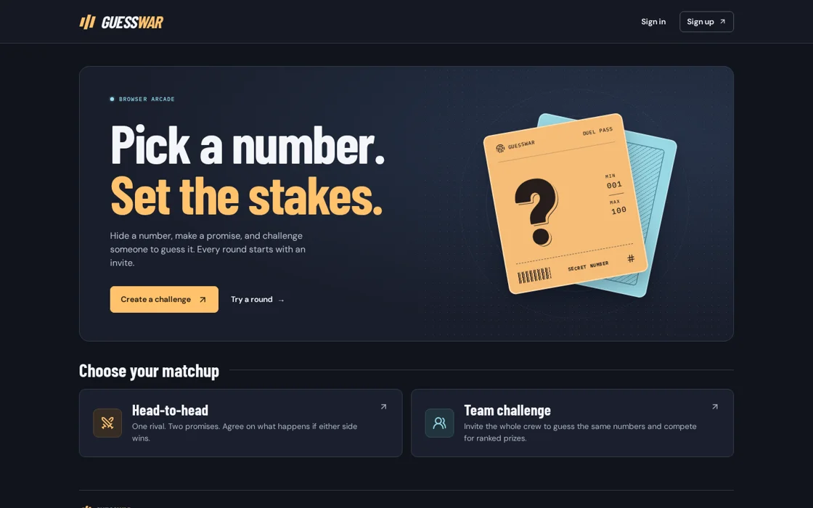

# GuessWar

A browser game for private number challenges. Hosts choose the secret numbers, limits, deadline and stakes. Players preview the invitation, sign in with the invited email, then accept and start a single run.



## Run locally

Use Python 3.12 and Node.js 22 or 24. Start the API in one terminal.

```sh
cd backend
python3 -m venv .venv
source .venv/bin/activate
pip install -r requirements.txt
export DJANGO_DEBUG=1
python manage.py migrate
python manage.py runserver 127.0.0.1:8000
```

Start the frontend in a second terminal.

```sh
cd frontend
npm ci
npm run dev
```

Open **http://localhost:3000**. The frontend forwards same-origin API requests to Django. Development signup codes appear in the API terminal. To deliver queued invitations locally, run the following from the backend directory with the virtual environment active.

```sh
DJANGO_DEBUG=1 python manage.py send_invites
```

The local email backend prints the invitation links. Hosts can also copy each recipient’s private invitation link from the challenge detail screen.

## Challenge rules

- A duel has one opponent and two commitments. The opponent wins by solving every round before the deadline.
- A team challenge accepts multiple email addresses and ranked prizes. Every player gets the same sequence of rounds. The final leaderboard opens at the deadline for completed runs. Ranking uses rounds solved, guesses consumed, then elapsed time. An exact tie shares a rank and prize.
- Hosts set up to 10 rounds, each with its own range and secret. The guess limit applies per round. Setting seconds per guess to zero disables that timer. The challenge deadline still applies.
- Accepting starts a run. Each timed-out turn consumes a guess, including time spent away from the page. Server time governs the outcome. Refreshing resumes the run. Each guess carries the expected turn revision to prevent a retry from spending another guess.
- Rewards and commitments are fulfilled by the participants. The app records the outcome.

## Hosting

The root Amplify build spec targets the Next.js app in `frontend`. Set `AMPLIFY_MONOREPO_APP_ROOT=frontend` and `API_ORIGIN` to the public HTTPS origin of your EC2 API before triggering the frontend build.

Run Django on EC2 behind an HTTPS reverse proxy, using a durable local volume for SQLite and regular backups. Apply migrations before starting Gunicorn. Set the following in the service environment.

| Variable | Value |
| --- | --- |
| DJANGO_SECRET_KEY | A generated private secret |
| DJANGO_ALLOWED_HOSTS | Comma-separated allowed API hostnames |
| WEB_ORIGIN | Exact HTTPS origin of the Amplify frontend or custom domain |
| DATABASE_PATH | Absolute path on a persistent volume writable by the API and invitation worker |
| SMTP_HOST, SMTP_PORT | Transactional SMTP host and port |
| SMTP_USER, SMTP_PASSWORD | SMTP credentials |
| SMTP_TLS, FROM_EMAIL | Use 1 for STARTTLS and configure a verified sender address |

Leave development mode disabled in production. From the backend working directory run `gunicorn config.wsgi:application --bind 127.0.0.1:8000`. Schedule `python manage.py send_invites` once per minute with the same environment as the API. Failed sends remain queued for retry. A host can see whether SMTP has accepted each invitation. Deployment and sender setup are external to this repository.

## Verification

```sh
cd backend
DJANGO_DEBUG=1 python manage.py test
cd ../frontend
npm ci
npm run build
```
